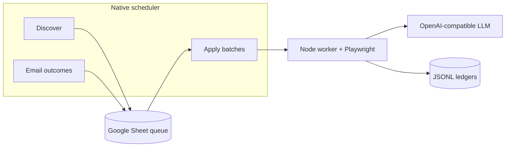

# Job Application Agent

**Status: complete and archived (October 2026).**  
This repository is published as a reference implementation. Scheduled job discovery and auto-apply are **turned off** by default (`NATIVE_SCHEDULER_ENABLED=false`). Do not run it against real job boards or inboxes without your own legal review, API keys, and consent.

A TypeScript worker that:

1. **Discovers** openings from configured boards and writes them to a Google Sheet queue.
2. **Scores fit** against a verified-facts profile (LLM-assisted, with hard gates).
3. **Generates** a tailored CV PDF per job from baseline PDFs plus verified facts.
4. **Applies** through Playwright (Comeet, Greenhouse, and similar) when `submit: true`, and records confirmations in JSONL ledgers.

Production used **native orchestration** (`ORCHESTRATION_MODE=native`): a Jerusalem-time scheduler, Postgres workspace config, and per-customer spreadsheets. Historical **n8n** workflow JSON lives under `orchestration/n8n/workflows/` for reference only.

## What you get in this repo

| Area | Location |
|------|----------|
| HTTP API + scheduler | `src/server.ts`, `src/orchestration/` |
| Browser apply pipeline | `src/application/`, `src/browser/` |
| Job discovery | `src/discovery/` |
| CV generation & truth gates | `src/cv/` |
| Workspace + Postgres | `src/orchestration/db.ts`, `workspace-store.ts` |
| MCP read-only gateway (optional) | `mcp-gateway/` |
| Ops scripts (daily report, repair, queue tools) | `scripts/` |
| Docker | `docker-compose.yml` |

## Architecture (high level)



- **Search Config** sheet tab drives category mix, minimum match score, and whether discover runs.
- **Budget** gates LLM spend (daily allowance derived from monthly cap in ILS).
- **Apply** only counts as success when a **confirmation** is detected in the browser; duplicates are blocked after confirmation.

## Quick start (local study)

**Requirements:** Docker, Node 22+, baseline CV PDFs, and env vars from `.env.example` (never commit real `.env`).

```bash
cp .env.example .env
# Fill APPLY_API_TOKEN, LLM_API_KEY, sheet/OAuth secrets for your own workspace.

docker compose up -d --build
curl -s http://127.0.0.1:3099/health
```

`/health` fails if baseline CVs are missing, Chromium cannot start, or the LLM key is missing.

### Preview a CV (no apply)

```bash
curl -s -X POST http://127.0.0.1:3099/cv/preview \
  -H "Authorization: Bearer $APPLY_API_TOKEN" \
  -H "Content-Type: application/json" \
  -d '{"job":{"role":"Example Role","company":"Example Co","url":"https://example.com/jobs/1"}}'
```

### Dry-run apply (`submit: false`)

Uploads generated CV and fills fields but does not click Submit. With `submit: true`, the worker submits once and ledger confirmation rules apply.

## Turning automation on or off

| Goal | Action |
|------|--------|
| **Archived default** | `NATIVE_SCHEDULER_ENABLED=false` (in `.env.example`) |
| **Enable daily runs** | Set `NATIVE_SCHEDULER_ENABLED=true`, `ORCHESTRATION_MODE=native`, configure `WORKSPACE_DATABASE_URL`, seed workspace (`scripts/seed-internal-workspace.mjs`) |
| **Stop a running server** | `docker compose stop` (all services); disable systemd units `jobagent-mcp-gateway` / `jobagent-mcp-tunnel` if installed; set `enabled=false` on workspace rows in Postgres |

Compose **`restart: "no"`** so containers do not come back after a host reboot unless you explicitly start them again.

## Daily operations (when automation was active)

```bash
python3 scripts/daily-apply-report.py
```

Read-only report: confirmed applications vs daily target, attempt ledger, blockers, manual CAPTCHA queue. See `.cursor/commands/daily-apply-report.md`.

## Search targeting (SSOT)

Native discover/apply reads the **Search Config** tab each run. Do not hard-code category weights in code for production; use `GET /search-policy` (Bearer `APPLY_API_TOKEN`) to inspect the active policy.

## MCP integration (optional)

Read-only MCP gateway for ChatGPT-style tools over audit data. See `docs/planning/CHATGPT_MCP_INTEGRATION.md`. Not required to understand the core apply loop.

## Retired / reference only

| Retired | Replacement in this repo |
|---------|---------------------------|
| `digitalab-creator/job-finder` (Apps Script) | Native worker + Sheet |
| Live n8n job crons on shared n8n | `orchestration/n8n/workflows/*.json` archive |

## Tests

```bash
npm ci && npm run build && npm test
```

## Security

- Keep `.env`, OAuth refresh tokens, and sheet IDs out of git (see `.gitignore`).
- `APPLY_API_TOKEN` protects all mutating HTTP routes.
- Treat browser profiles and ledgers as sensitive (PII).

## License

No license file is included; treat the code as **all rights reserved** unless the repository owner adds an explicit license. Fork and reuse at your own risk.

## Why this project stopped

The personal automation goal was met for its phase: discovery, fit gating, CV tailoring, and guarded submit were built and operated on a private stack. Further work (multi-tenant productization, CAPTCHA-at-scale, compliance packaging) is out of scope for this archive.
